# Phase 2 ERD — School management, scoped staff and QR attendance

```mermaid
erDiagram
 AppUser ||--o{ AuthSession : has
 AppUser ||--o{ RoleAssignment : holds
 AccessScope ||--o{ RoleAssignment : restricts
 AppUser ||--o{ SensitiveAccessGrant : requests
 AccessScope ||--o{ SensitiveAccessGrant : targets
 MenStudent ||--o{ MenGuardianLink : linked_to
 MenStudent ||--o{ MenEnrollment : enrolls
 MenClassGroup ||--o{ MenEnrollment : includes
 MenClassGroup ||--o{ MenTeacherAssignment : teaches
 MenClassGroup ||--o{ MenLessonSession : schedules
 MenLessonSession ||--o{ MenAttendance : records
 MenStudent ||--o{ MenAttendance : attends
 MenStudent ||--o{ MenQrCredential : owns
 WomenStudent ||--o{ WomenGuardianLink : linked_to
 WomenStudent ||--o{ WomenEnrollment : enrolls
 WomenClassGroup ||--o{ WomenEnrollment : includes
 WomenClassGroup ||--o{ WomenTeacherAssignment : teaches
 WomenClassGroup ||--o{ WomenLessonSession : schedules
 WomenLessonSession ||--o{ WomenAttendance : records
 WomenStudent ||--o{ WomenAttendance : attends
 WomenStudent ||--o{ WomenQrCredential : owns
 AcademyStudent ||--o{ AcademyGuardianLink : linked_to
 AcademyStudent ||--o{ AcademyEnrollment : enrolls
 AcademyClassGroup ||--o{ AcademyEnrollment : includes
 AcademyClassGroup ||--o{ AcademyTeacherAssignment : teaches
 AcademyClassGroup ||--o{ AcademyLessonSession : schedules
 AcademyLessonSession ||--o{ AcademyAttendance : records
 AcademyStudent ||--o{ AcademyAttendance : attends
 AcademyStudent ||--o{ AcademyQrCredential : owns
```

These three sections represent independent physical tables in `hifz_men`, `hifz_women`, `academy`. `core` holds identity and approval metadata but NO women student names or private records. Each sensitive read logs an `AuditEvent` in `core`. DB constraints enforce one attendance per student per session and unique QR token hashes.

## Scope and role rules
- `SUPER_ADMIN` + `SCHOOL`: full administrative rights in men and academy. **Women require approved, expiring grant** signed by a `HIFZ_WOMEN` `SUPERVISOR`; a manager cannot approve their own request.
- Scoped `SUPERVISOR`: manage section and approve only women's grants if specifically assigned to women.
- Scoped `RECEPTION`: create students, groups and attendance; read section only.
- Scoped `TEACHER`: roster, session and attendance restricted to assigned groups. No student creation, no QR issue.
- Scoped `PARENT`, `STUDENT`: only direct linked profile via `/api/portal` (no administrative listing).
- Women and men teaching assignments validated against `AppUser.gender`.

## Important privacy and operational boundaries
- Backend must run using **separate credentials** for the auth database and for each operational section. Deployment with `DATABASE_URL` owner in runtime is prohibited.
- Printable QR cards are distributed as a QR image (opaque random 256-bit token); token plaintext is available on issuance **once**. Staff scan requires authenticated session and session ID; GET never records attendance. Rotating a credential revokes the old one.
- UI uses browser print / **Save as PDF**; it does not yet generate a native server-side PDF endpoint.
- QR scans are marked present or late using a configurable-by-code 10-minute threshold, and rejected outside the one-hour grace window. Manual absences can be recorded by a staff member only with a written reason.
- Deliberately not implemented yet: payment, push notifications, auto absence job, recurring schedules with collision detection, automated certificate PDFs, audio corrections, production single sign-on and MFA. No production data until security tests and operational approvals.
