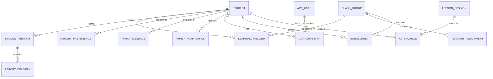

# Phase 3 ERD additions

The diagram applies separately within `hifz_men`, `hifz_women` and `academy`. This is **not** a merged shared schema.

- Scope-controlled model names: `MenLearningRecord`, `WomenLearningRecord`, `AcademyLearningRecord`, likewise for reports, preferences, deliveries, messages, notifications.
- `LearningRecord`: `studentId`, `groupId`, `teacherId`, `activity`, `surahNumber`, verse range, mastery, errors, note and assessment date.
- `StudentReport`: period and start date unique per student; snapshot immutable after `PUBLISHED` through guarded application logic. Add SQL defensive trigger before production if regulatory audit immutability is needed.
- `ReportPreference` keyed by student + guardian; email starts disabled. Teacher approval default required.
- `ReportDelivery` unique by report, guardian and method. Resend idempotency key is delivery UUID.
- Student and guardian PII are not embedded into emails or stored in shared notification tables.
