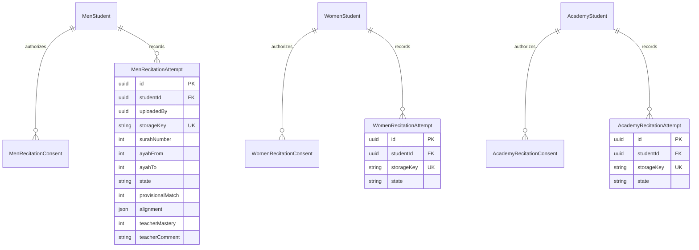

# ERD stage 4 (extends stage 1–3)

Three independent schemas store the same logical pair of tables: `hifz_men`, `hifz_women`, `academy`. No data is moved into `core` except append-only security audit metadata.

- For minors, a linked guardian grants or revokes consent. Adults grant themselves consent. The signed-in student cannot authorize recordings as a minor.
- Uploaded recordings are stored in separate private object-storage buckets with separate access keys for each scope. The DB only stores the key and metadata.
- The processing worker checks consent again just before ASR, atomically claims queued jobs and stores provisional diffs. It NEVER writes `LearningRecord` academic grades.
- Teacher review validates assigned group / supervision, then writes `LearningRecord` using **manual** teacher values. Audit entries track upload, read, review and deletion.
