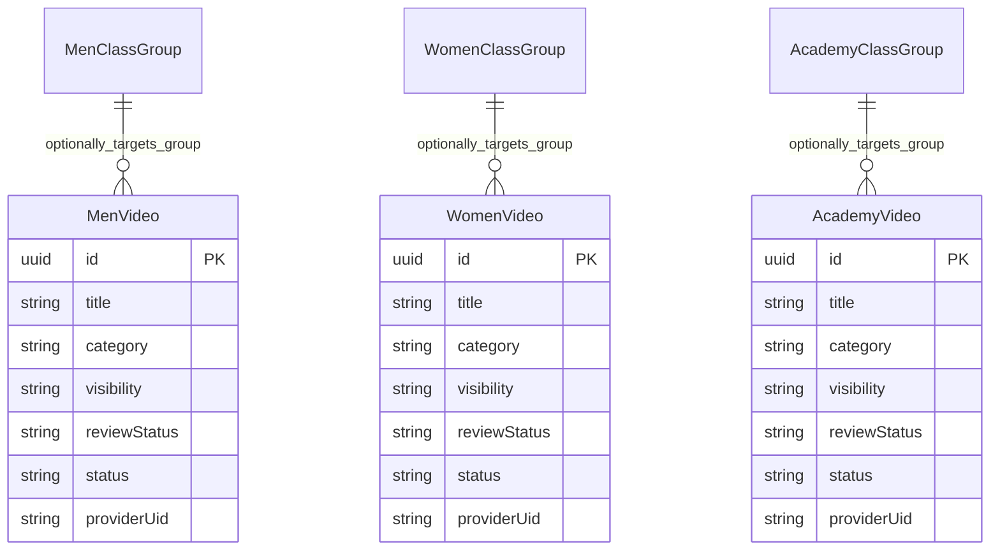

# ERD — Phase 5 Video Library

All three video tables have identical columns but physically different schemas. No video descriptions or private media identity are stored in `core`.

`groupId` is a foreign key within the corresponding schema. `levelId` targets the existing program level logically and must match an active group within the same scope. The API validates this target, as the schema-level FK to core Level is not added in this phase. `uploadedBy` and `reviewedBy` are account identifiers from core. Authentication and role/scope checks are run before any cross-scope metadata lookup. Provider accounts are distinct for women, men, and academy.

Playback is always issued using a fresh, 10-minute provider token. `visibility` = `PUBLIC` (academy only), `ENROLLED`, `LEVEL`, or `GROUP`; upload state and reviewer decision must BOTH allow publication. Soft deletion immediately revokes playback issuance and triggers provider cleanup.
