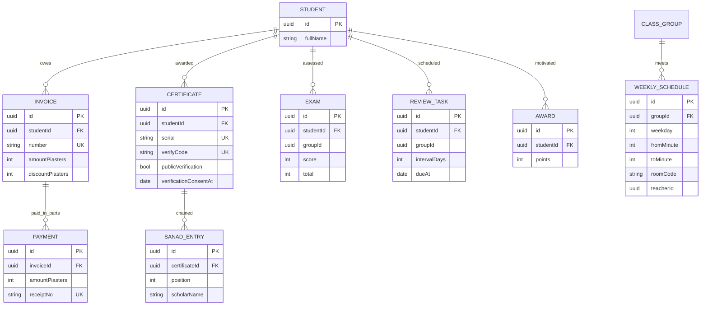

# Phase 6 data relationships — physical three-schema isolation

The following eight models are duplicated separately under **hifz_men**, **hifz_women** and **academy**. No common student table is introduced. This diagram applies *once per schema*.

The operational ERD is implemented in `prisma/schema.prisma`. SQL `db/constraints-stage6.sql` adds non-overlapping weekly ranges for each section (group, teacher, room) using GiST exclusion constraints. **Cross-schema physical-room conflicts are not yet blocked**, so each section must use independently labeled rooms until a central reservation service is implemented. In the future a room-availability service should store only occupied time ranges in `core`, never women's student/teacher details.
